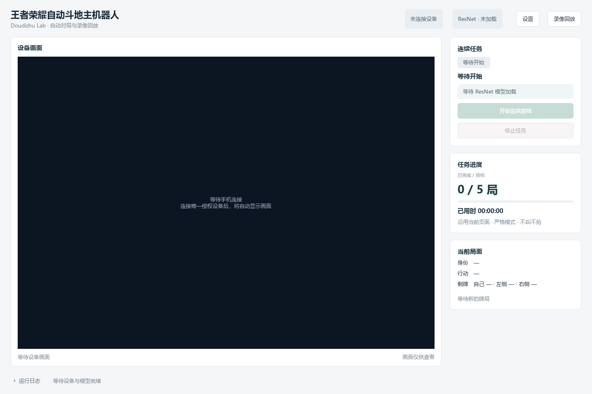

# 王者荣耀自动斗地主机器人 · Doudizhu Lab

Doudizhu Lab 是面向**王者荣耀内的斗地主玩法**的自动斗地主机器人。通过 USB 连接安卓手机，在 Windows 上采集游戏画面、识别公开局面，使用本地 DouZero 模型决策并操作手机，完成匹配、叫抢、出牌和连续续局。

**当前处于实验阶段，需要适用于当前设备和游戏布局的模板与操作标定。** 软件启动后加载本地模型并只读预览；点击“开始连续游戏”或显式使用 `--continuous` 后才开始自动操作。

## 软件截图



工作台主界面展示设备画面、连续任务、任务进度和当前局面。截图为未连接手机、未加载模型的初始状态。

## 自动对局能力

- **匹配与续局**：从王者荣耀内的斗地主大厅开始匹配，或从结算页继续下一局，沿用当前页面。不按洗牌、不洗牌或场次名称限制入口，出牌使用标准 54 张牌规则。
- **模型出牌**：默认使用 DouZero ResNet 在 CPU 上推理，可切换 WP；逐张选牌、提交前核对，并通过后续画面确认实际动作。
- **可选模型叫抢**：支持本地叫抢模型与可配置阈值；新配置默认固定不叫不抢，所有策略始终不加倍。
- **连续游戏与恢复**：按目标有效局数运行，默认 5 局，不设任务总时长；异常局隔离、故障工作进程重建，保留已完成进度，外部条件恢复后继续。
- **局面识别与动作复核**：识别手牌、底牌、各家出牌、阶段、地主、剩牌数及行动提示。所有模式接受可独立复核的确定性推断，平衡模式另外允许明确回合的规则接管。

录像、回放纠错和离线评测用于排查自动对局问题：独立进程采集并分段保存 MKV，SQLite 保存原始观察、事件、修订和动作账本，每局计数前独立复核证据。正常局及主动中止局清理临时录像，异常局按留存规则保留故障资料。运行数据保存在本机，默认不上传。

## 运行准备

- **电脑环境**：Windows、Python 3.11 和 [uv](https://docs.astral.sh/uv/)。其他系统尚未完成设备与窗口验收。
- **手机连接**：安卓真机、可传输数据的 USB 线及 Android Platform Tools（ADB）；在手机上开启 USB 调试并授权电脑。
- **本地组件**：出牌模型、叫抢模型、流程 OCR 模型及视频组件，使用下方准备命令独立下载并校验。
- **游戏布局**：准备当前设备的牌面模板、识别区域和按钮标定。默认区域以 2400×1080 的王者荣耀经典牌桌为参考，仍需核对实际布局。

仓库与发行包不附带模型权重、游戏图片、牌面模板、手机配置或历史录像。日常界面没有首次标定向导，新设备适配方式见[标定配置](docs/calibration.md)。

## 快速开始

### 1. 安装依赖

在项目目录执行，`vision` 额外依赖用于连续流程与可选手牌 OCR：

```powershell
uv sync --frozen --extra vision
uv run --extra vision ddz-lab --version
```

### 2. 准备模型和视频组件

```powershell
uv run --extra vision ddz-check setup-video
uv run --extra vision ddz-check setup-agent
uv run --extra vision ddz-check setup-bidding
uv run --extra vision ddz-check setup-vision
```

这些命令显式下载固定版本并校验文件；正式运行只加载本地组件。默认准备 ResNet，WP 的准备与切换方法见[模型与连续运行](docs/agent-and-continuous.md)。

### 3. 连接手机并确认标定

连接并授权手机，准备好适配当前布局的模板和操作标定。进入王者荣耀内的斗地主大厅或结算页，再启动工作台：

```powershell
uv run --extra vision ddz-lab
```

唯一授权设备会自动显示只读画面；多台设备时在设置中选择目标。启动后后台加载所选本地模型，默认 ResNet，加载和预览本身不开始游戏。

### 4. 开始自动对局

在设置中确认出牌模型、连续策略、叫抢策略和目标局数，模型就绪后点击“开始连续游戏”。需要自动叫抢时选择“模型自动叫抢”并确认阈值。大厅从匹配开始，结算页从下一局开始计数；已有牌局尚未结束时只读等待。

也可通过命令行显式启动连续任务，例如启用模型叫抢并完成 5 局：

```powershell
uv run --extra vision ddz-lab --continuous --bidding model --max-games 5
```

“停止任务”撤销后续自动输入并在后台收尾，结束后恢复只读预览。完整连接步骤、设置与常见问题见[安装与启动](docs/getting-started.md)。`ddz-device` 保留为兼容启动命令，`ddz-check` 提供诊断与组件准备命令。

### 不连接手机的演示

模型准备完成后，可先运行离线模拟窗口：

```powershell
uv run --extra vision ddz-bot-demo
```

演示使用模拟设备，用于检查界面和自动对局流程，不代表真实游戏画面的识别或操作成功率。

## 适配与验证状态

当前只完成 Windows 与特定王者荣耀斗地主布局的验证，设备分辨率、动画、遮挡和叠牌都可能影响识别。入口不限制玩法名称，模型和合法动作仍基于单副 54 张牌标准规则，未新增癞子、多副牌或特殊牌型支持。

**真机连续 30 局严格验收尚未通过，实时整局事件识别的正式验收也仍未通过。** 重构前的单个真机任务连续完成 15 局、14 次衔接及 170 次本人动作确认，第 16 局被游戏健康系统强制休息中断。15 局中 138 次动作为 DouZero WP、32 次为规则策略，另有 1 个事件通过独立证据推断；这些不能合称全程模型出牌，也不代表对战胜率。

离线模拟、历史数据回归与真机成绩分别统计，后续检查和历史批次详情见[验证状态](docs/validation.md)。默认视频上限 15 FPS、识别上限 10 FPS 是调度参数，不是所有设备的实测保证。

未知提交不会盲目重试；健康系统、账户验证及充值等提示需要外部条件恢复或人工处理。恢复机制覆盖本次任务的工作进程与可恢复条件，桌面程序崩溃、手机游戏重启及开机自动恢复不在当前范围内。

## 文档

| 主题 | 入口 |
| --- | --- |
| 安装、手机连接与常见问题 | [安装与启动](docs/getting-started.md) |
| 数据目录、ADB 与配置兼容 | [配置说明](docs/configuration.md) |
| 已有模板、区域和操作布局 | [标定配置](docs/calibration.md) |
| 模型、推断、连续任务与自动恢复 | [模型与连续运行](docs/agent-and-continuous.md) |
| 录像、回放纠错及命令行重算 | [记录与回放](docs/recording-and-replay.md) |
| 模块职责与公共数据接口 | [架构](docs/architecture.md) |
| 实测程度与历次检查 | [验证状态](docs/validation.md) |
| 固定来源、许可与第三方改动 | [第三方来源](docs/third-party.md) |
| 旧项目到 0.5 版的变化 | [迁移说明](docs/migration.md) |

## 开发

```powershell
uv run ruff check .
uv run ruff format --check .
uv run pytest -m "not local_data and not model" -q
uv build
uv run python tools/check_distribution.py
```

公共测试使用合成数据和模拟设备，不下载权重、不连接手机。完整可选回归、中文接口规范与提交说明见[贡献指南](CONTRIBUTING.md)。

## 许可

原创代码采用[Apache-2.0](LICENSE)。第三方源码、依赖、模型和游戏素材保留各自权利，详见[NOTICE](NOTICE)和[来源说明](docs/third-party.md)。本项目与游戏或模型发布方没有隶属或背书关系。隐私问题见[安全说明](SECURITY.md)。
